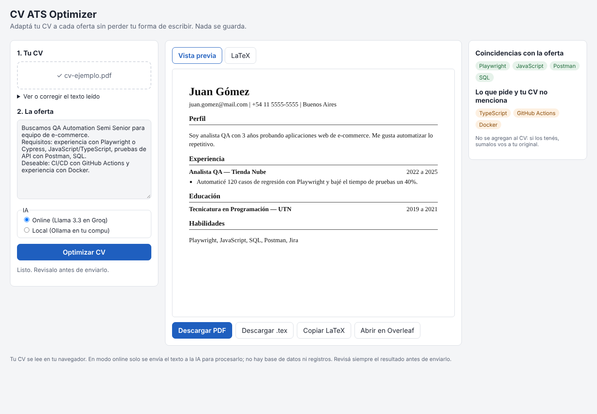

# CV ATS Optimizer

[](https://github.com/scheffan/cv-ats-optimizer/actions/workflows/tests.yml)
[](https://github.com/scheffan/cv-ats-optimizer/actions/workflows/publicar.yml)


Web gratuita para adaptar tu CV a una oferta laboral puntual. Subís tu CV, pegás la publicación y en unos segundos tenés una versión de una columna, en LaTeX y PDF, pensada para pasar los filtros ATS.

**Probalo acá:** https://scheffan.github.io/cv-ats-optimizer/



## Qué hace

- Lee tu CV en PDF, DOCX o TXT **dentro del navegador** (el archivo no se sube a ningún lado).
- Cruza el CV con la oferta usando un modelo de lenguaje abierto (gpt-oss 120B en Groq, o Llama en tu compu con Ollama) y reordena todo para priorizar lo que coincide.
- Mantiene tu tono: misma persona, mismo registro y mismo idioma. La idea es que cada CV siga sonando a vos y no a una plantilla.
- **No inventa nada.** Lo que la oferta pide y tu CV no tiene aparece aparte, como "faltantes", para que decidas vos.
- Además, un control propio revisa el resultado y avisa si aparece una empresa, fecha o número que no estaba en tu original.
- Si te olvidaste de poner algo que la oferta pide (por ejemplo, usaste Playwright pero no lo pusiste), lo sumás desde la lista de faltantes, elegís en qué experiencia lo usaste y tocás "Actualizar CV".
- Genera el CV en español o en inglés (traduce con fidelidad si tu original está en otro idioma).
- Exporta a PDF, a `.tex` o lo abre directo en Overleaf.

## Privacidad

No hay base de datos, ni cuentas, ni registros. El texto del CV viaja solo para procesarse: el Worker no guarda nada, responde con `Cache-Control: no-store` y tiene los logs desactivados. Las librerías se sirven desde el mismo sitio, sin CDNs ni analíticas de terceros (hay un test E2E que lo verifica).

Si querés que no salga nada de tu compu, usá el **modo local** con Ollama.

## Cómo está armado

```
Navegador (GitHub Pages)                 Cloudflare Worker              Groq
┌──────────────────────────┐   texto    ┌──────────────────────┐       ┌──────────────┐
│ pdf.js / mammoth: lee CV │ ─────────> │ valida y limita x IP │ ────> │ gpt-oss-120b │
│ arma LaTeX y PDF         │ <───────── │ clave API escondida  │ <──── │ (JSON)       │
│ verifica que no invente  │    JSON    │ no guarda nada       │       └──────────────┘
└──────────────────────────┘            └──────────────────────┘
```

- **Front:** HTML, CSS y JavaScript sin frameworks, publicado en GitHub Pages.
- **Back:** un Cloudflare Worker (plan gratis) que guarda la clave de Groq como secreto, acepta solo pedidos de la web y limita a 5 pedidos por minuto por IP. Si un modelo falla, se queda sin cuota o Groq lo retira, pasa al siguiente de la lista `MODELOS` de `worker/wrangler.toml`, que se cambia sin tocar código.
- **IA:** la API gratuita de Groq. El modelo devuelve JSON y la plantilla LaTeX se arma en el navegador, así el formato siempre sale prolijo y escapado.

## Tests

| Tipo | Qué cubre | Cantidad |
|---|---|---|
| Unitarios (`node:test`) | Escapado LaTeX, instrucciones, validación, normalización, detector de datos inventados, PDF y Worker (CORS, límite por IP, cambio de modelo, modelos retirados, errores), proyectos, idioma, datos agregados | 32 |
| E2E (Playwright, escritorio y celular) | Lectura de PDF real, flujo completo, descargas, aviso de datos inventados, errores, XSS y que no se carguen dominios externos | 22 |
| LaTeX (CI) | Compila la plantilla con `pdflatex`, incluso con caracteres como `# & % _ \` | 1 |

```bash
npm ci
npm test            # unitarios
npm run test:e2e    # Playwright
```

## Correrlo en tu compu

```bash
npm ci
npm run dev         # web en http://localhost:5173
```

**Con Groq:** creá una clave gratis en https://console.groq.com/keys, copiá `worker/.dev.vars.example` como `worker/.dev.vars` y en otra terminal corré `cd worker && npx wrangler dev`.

**Con Ollama (100% local):**

```bash
ollama pull llama3.1:8b
# Windows (PowerShell), para que el navegador pueda hablar con Ollama:
setx OLLAMA_ORIGINS "http://localhost:5173,https://scheffan.github.io"
```

Reiniciá Ollama y elegí "Local" en la web.

## Publicarlo

Todo se publica solo con el workflow `Publicar` en cada push a `main`: primero el Worker en Cloudflare y después la web en GitHub Pages, ya conectada al Worker.

Una sola vez hay que:

1. En **Settings > Pages**, elegir *GitHub Actions* como fuente.
2. Crear una clave gratis en [Groq](https://console.groq.com/keys) y un token de [Cloudflare](https://dash.cloudflare.com/profile/api-tokens) con la plantilla *Edit Cloudflare Workers*.
3. Cargarlos en **Settings > Secrets and variables > Actions** como `GROQ_API_KEY` y `CLOUDFLARE_API_TOKEN`.

## Licencia

MIT
